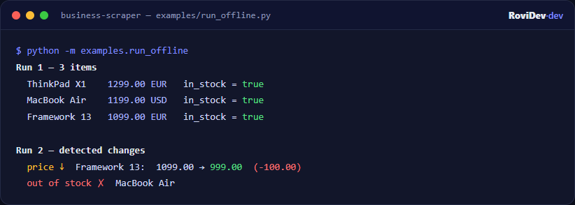

# business-scraper

[](https://github.com/rovidev95/rovidev-business-scraper/actions/workflows/ci.yml)
[](LICENSE)


[](https://render.com/deploy?repo=https://github.com/rovidev95/rovidev-business-scraper)

Monitors prices and availability on public web pages. You describe a page with
CSS selectors, and it returns clean, typed items and tells you what changed since
the last run — price drops, items going out of stock, new or removed listings.

It is built to scrape **politely**: `robots.txt` is honored by default and a
per-host rate limiter spaces out requests. The fetcher is injected, so the same
pipeline runs against live sites or against fixtures in tests.

> Use it on data you are allowed to access, respect each site's terms of service
> and keep request rates reasonable.



## Install

```bash
pip install -e ".[dev]"
```

## Try it (no network)

```bash
python -m examples.run_offline
```

This serves two versions of a catalog page from memory so you can see the change
detection (a price drop and an item going out of stock) between two runs.

## Describe a source

A source is JSON: the page URL, a selector for each item, and the fields to pull
from each item. `attr` reads an HTML attribute; without it the element text is used.

```json
{
  "name": "books-mystery",
  "url": "https://books.toscrape.com/catalogue/category/books/mystery_3/index.html",
  "item_selector": "article.product_pod",
  "key_field": "url",
  "fields": {
    "title": { "selector": "h3 a", "attr": "title" },
    "price": { "selector": ".price_color" },
    "availability": { "selector": ".availability" },
    "url": { "selector": "h3 a", "attr": "href" }
  }
}
```

`price` is parsed into a number and currency (EU and US separators both work),
and `availability` text is mapped to an in-stock flag.

## Run it

```bash
business-scraper --sources examples/sources.example.json --json out.json --csv out.csv
```

Snapshots are stored under `SCRAPER_STATE_DIR` (default `data/state`), so the
next run reports the difference. Schedule it with cron/systemd to get a recurring
price monitor.

## HTTP API

```bash
uvicorn scraper.api:app --reload   # docs at /docs
```

```bash
curl -X POST localhost:8000/scrape -H 'content-type: application/json' \
  -d @examples/sources.example.json   # send a single source object
```

`POST /scrape` returns the items plus the computed changes; `GET /sources/{name}`
returns the last stored snapshot.

## Export targets

Built-in sinks: JSON, CSV and in-memory. A Google Sheets sink ships behind the
`sheets` extra:

```bash
pip install -e ".[sheets]"
```

```python
from scraper.sinks import GoogleSheetsSink

sink = GoogleSheetsSink("service-account.json", spreadsheet_id="...")
```

Sinks are a one-method interface, so adding Postgres, Slack alerts, etc. is small.

## Layout

```
scraper/
  models.py      source spec + scraped item + change set
  config.py      env settings + source loading
  robots.py      robots.txt parsing
  rate_limit.py  per-host politeness delay
  fetcher.py     httpx fetcher (retries) + Fetcher protocol
  extract.py     HTML -> raw fields (BeautifulSoup)
  normalize.py   price / currency / stock parsing
  changes.py     snapshot diffing
  state.py       JSON / in-memory snapshot stores
  sinks.py       JSON / CSV / Sheets outputs
  pipeline.py    fetch -> extract -> normalize -> diff
  cli.py         command-line runner
  api.py         FastAPI app
```

## Tests

```bash
pytest -q
ruff check .
```

## Custom work

Need a scraper or price-monitoring pipeline built for your data sources?
Get in touch at [rovidev.com](https://rovidev.com).

## License

MIT
